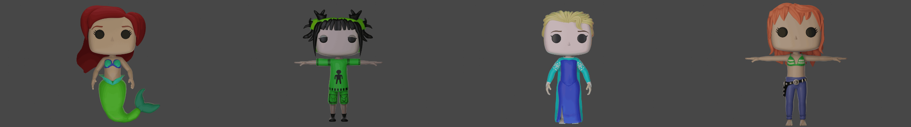
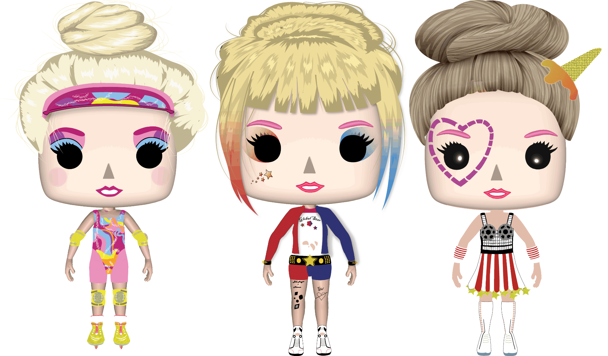
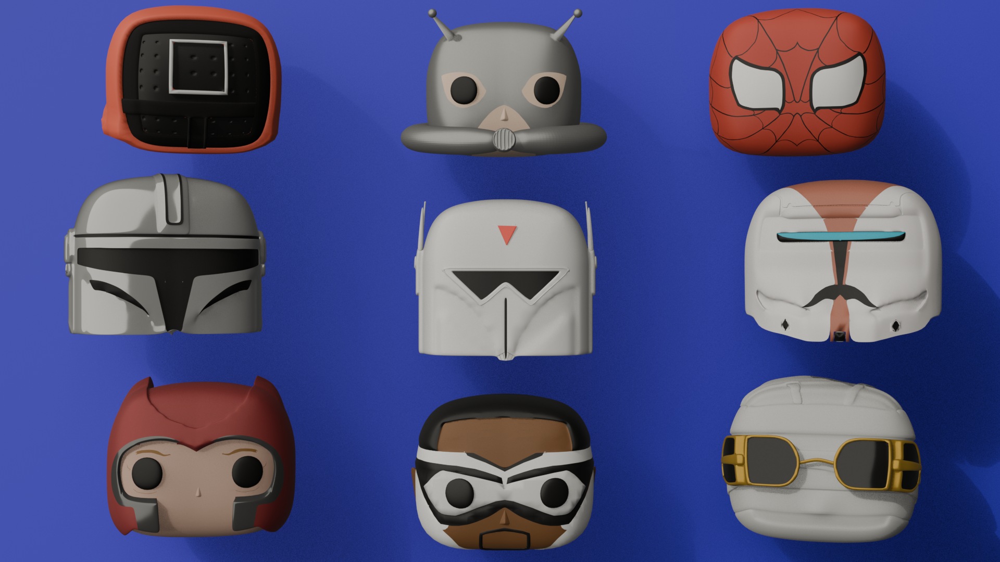
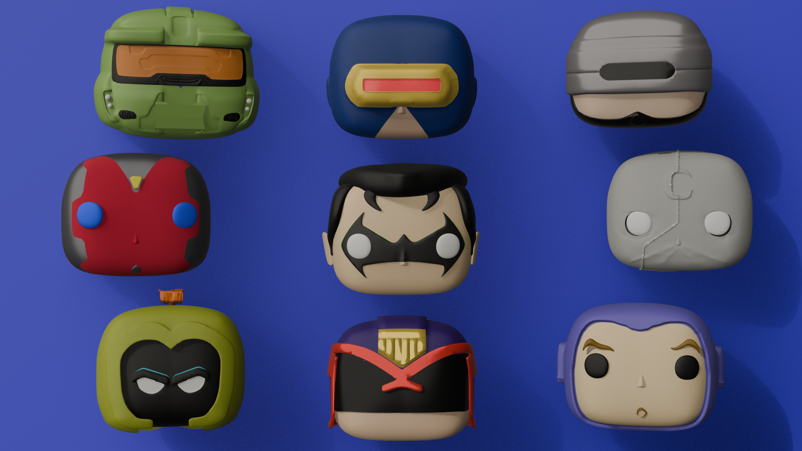

# Mobile Game Art Portfolio

A selection of stylized 3D character-production work and mobile-gameplay samples.

## Featured Character Projects

### ColorShop — Stylized 3D Character Production

**Gameplay:** [Watch ColorShop gameplay on YouTube](https://youtube.com/shorts/GoeY977R3BE)

**My contributions:**
- Character planning
- 3D modeling and sculpting
- Texturing and material creation
- Character rigging
- Game testing and visual quality checks

### Pop Doll — Stylized 3D Character Production

**Gameplay:** [Watch Pop Doll gameplay on YouTube](https://youtube.com/shorts/fJhb45M7Hio)

**My contributions:**
- Character planning
- 3D modeling and sculpting
- Texturing and material creation
- Character rigging
- Game testing and visual quality checks

### Mobile Game Head Characters — Character Art Production

A collection of stylized character-head assets created for a mobile game. The sheets show a range of character designs and demonstrate consistency across a multi-character asset set.

**Gameplay:** [Watch head-character gameplay on YouTube](https://youtube.com/shorts/Kb0xbw55CRo)

**Work represented:** stylized 3D character-head production for mobile-game use.

## Additional Character Art

See [`Character-Art/`](Character-Art/) for the original character sheets.

## Gameplay Footage

The `Gameplay-Footage/` folder contains additional mobile-gameplay samples. The featured project videos are linked above and hosted on YouTube to keep this repository lightweight.

## Scope of Work

For ColorShop and Pop Doll, my responsibilities covered character planning, modeling, sculpting, texturing, rigging, and game testing. The head-character gameplay link provides an in-game context for the character-head asset work. These descriptions identify my contributions and do not imply that I developed the games themselves.
