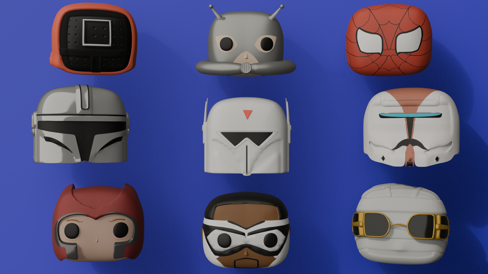
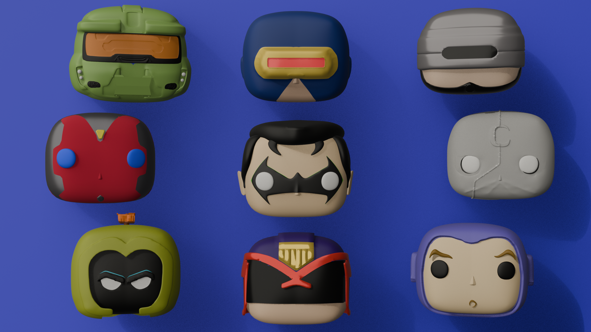
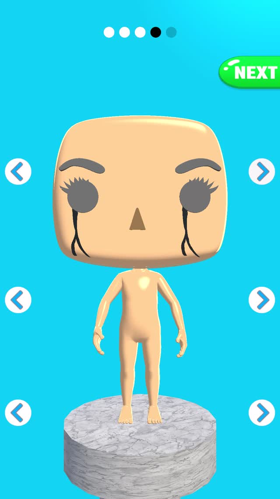
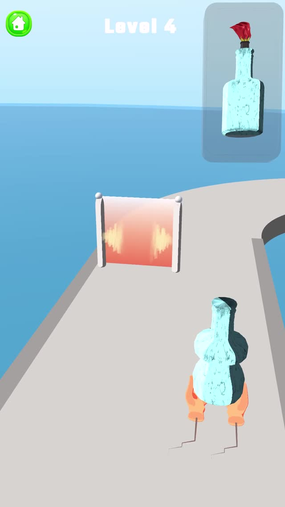
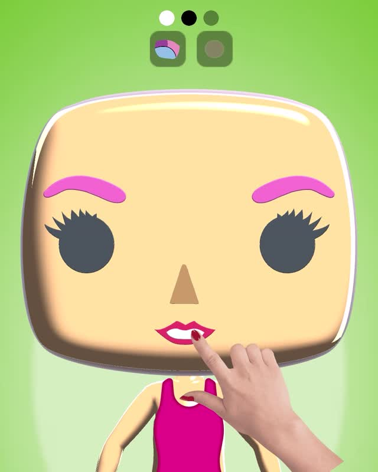

# Selected Mobile Game Art & Production Work

A curated selection of art assets and gameplay footage from mobile game projects I contributed to, alongside examples of stylized character art.

**Focus:** stylized 3D character art, asset creation, and visual production for mobile games.

> **Portfolio note:** The videos are included as project-context footage to show the assets in-game. They are not intended to imply that I developed every gameplay system shown. My contribution descriptions should be kept specific to the work I personally created.

## Character Art

A selection of stylized character-head work created for mobile game production. Approximately 30 character heads were produced for a mobile game project, with attention to a consistent visual style and mobile-friendly asset requirements.

| Character sheet 01 | Character sheet 02 |
|---|---|
|  |  |

## Selected Gameplay Footage

The following clips provide context for the projects and their visual style. Only claim the art, modeling, texturing, or other tasks that you personally completed for each project.

### 1. DIY Pop Doll — gameplay context

[Watch / download gameplay video](Gameplay-Footage/DIY-Pop-Doll-Gameplay.mp4)

### 2. Runner — gameplay context

[Watch / download gameplay video](Gameplay-Footage/Runner-Gameplay.mp4)

### 3. Doll Customization — gameplay context

[Watch / download gameplay video](Gameplay-Footage/Doll-Customization-Gameplay.mp4)

## Production Context

- Work shown here relates to mobile game projects whose gameplay was tested with Moonee and/or CrazyLabs.
- This repository is a portfolio presentation of selected work, not a claim of employment by either company.
- Gameplay clips are included to demonstrate the assets in their intended context; they should not be read as a claim of authorship for the complete game.

## Tools & Skills

- Blender — 3D modeling and character-art production
- Stylized character design and asset creation
- Mobile-game art asset preparation

## Contact

**Mihir Pathak**  
Email: [mihirpathak2901@gmail.com](mailto:mihirpathak2901@gmail.com)  
Portfolio: [https://mihirp-in.github.io/](https://mihirp-in.github.io/)  
GitHub: [https://github.com/MihirP-In](https://github.com/MihirP-In)

---

Before publishing, confirm that you have permission to publicly share each production asset and gameplay clip, and remove any confidential or unreleased material.
